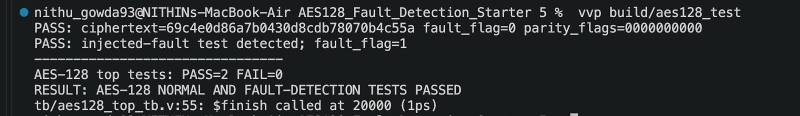
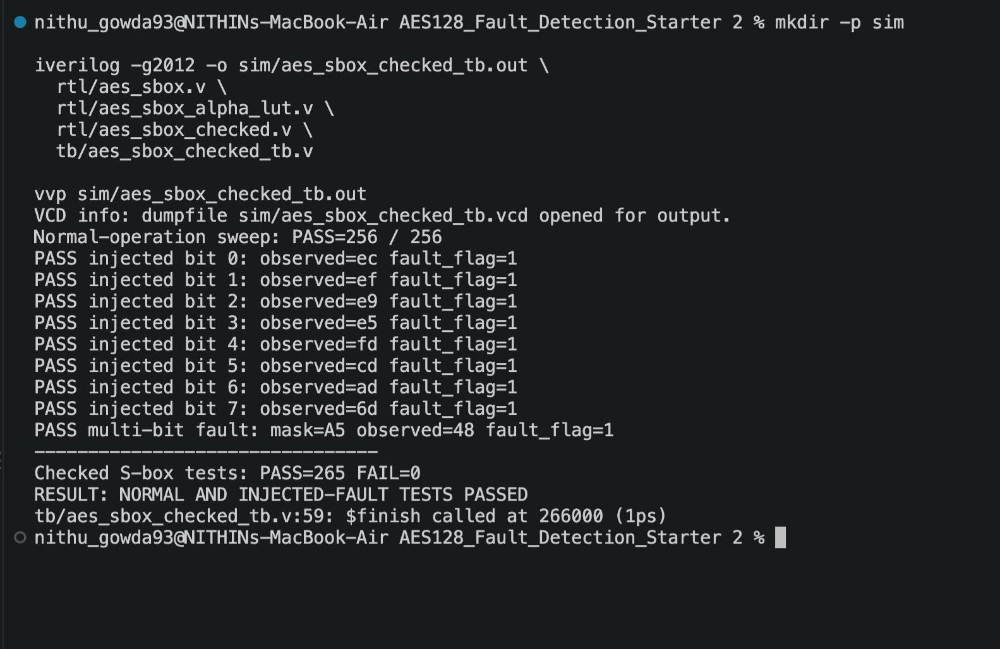
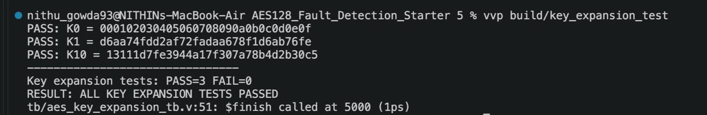
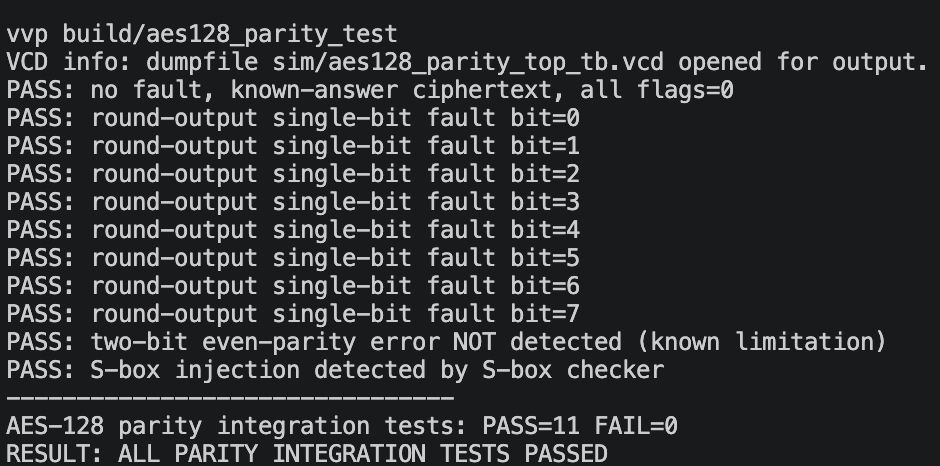

# AES-128 Encryption with Fault Detection

Simulation-only project using Icarus Verilog and GTKWave.

## Verified baseline
- AES S-box directed tests passed.
- AES-128 key expansion K0, K1, K10 checks passed.
- AES round reference test passed.
- Complete AES-128 known-answer test passed for plaintext `00112233445566778899aabbccddeeff`, key `000102030405060708090a0b0c0d0e0f`, ciphertext `69c4e0d86a7b0430d8cdb78070b4c55a`.

## Paper-inspired S-box checker prototype
`rtl/aes_sbox_checked.v` models the input/output relation described in the supplied paper. This simple version derives its prediction from the same S-box output, so it is a conceptual prototype and does NOT independently detect an injected corruption of that output. A meaningful hardware fault-injection experiment needs an independent predictor/check path or a controllable fault point and should be clearly described as a simplified simulation model if used.

## Run normal-operation checker tests
```bash
mkdir -p sim
iverilog -g2012 -o sim/aes_sbox_checked_tb.out rtl/aes_sbox.v rtl/aes_sbox_checked.v tb/aes_sbox_checked_tb.v
vvp sim/aes_sbox_checked_tb.out
```

Do not claim the base paper's 99.998% fault coverage for this project without reproducing the relevant fault model and measurements.


## S-box fault checker simulation (updated)

The checker uses `rtl/aes_sbox_alpha_lut.v`, a separately stored 256-entry lookup table for `alpha[x] = x XOR SBOX[x]`. `fault_mask` is a **simulation-only test hook** that flips selected bits after the functional S-box. The checker compares the alpha-derived predicted output against the observed (possibly corrupted) output.

Run from the project root:

```bash
mkdir -p sim
iverilog -g2012 -o sim/aes_sbox_checked_tb.out \
  rtl/aes_sbox.v rtl/aes_sbox_alpha_lut.v rtl/aes_sbox_checked.v \
  tb/aes_sbox_checked_tb.v
vvp sim/aes_sbox_checked_tb.out
```

The testbench sweeps all 256 input values without faults, injects each of the 8 single-bit output flips at input `53`, and injects a multi-bit mask `A5`. These results only establish detection for this modeled output-corruption point. They do not establish physical fault coverage, detection of faults in the alpha table/checker itself, or reproduction of the paper's reported coverage.


## Version 7: checked S-box integrated into AES-128

The AES round now uses `aes_sbox_checked` for each of its 16 S-boxes. The top-level module aggregates the round-level fault flags into `fault_flag`. `sbox_fault_mask` is a **simulation-only test hook** applied to each round; set it to zero for normal encryption. A nonzero mask intentionally corrupts the selected S-box output bits so the testbench can verify detection. This is not a physical fault injection port recommendation for a production design.

### Top-level simulation

```bash
mkdir -p sim
iverilog -g2012 -o sim/aes128_top_tb.out \
  rtl/aes_sbox.v \
  rtl/aes_sbox_alpha_lut.v \
  rtl/aes_sbox_checked.v \
  rtl/aes_key_expansion.v \
  rtl/aes_round.v \
  rtl/aes128_top.v \
  tb/aes128_top_tb.v
vvp sim/aes128_top_tb.out
```

Expected checks: the no-fault NIST known-answer vector produces `69c4e0d86a7b0430d8cdb78070b4c55a` with `fault_flag=0`; the injected-fault test sets `fault_flag=1`. These tests validate this specific modeled fault, not exhaustive fault coverage.

## Version 9 parity checker validation

See `README_V9.md` for the focused round parity predictor test. It checks all 128 single-bit output fault positions and demonstrates a two-bit even-parity limitation. These are simulation checks for the modeled fault boundary, not a claim of exhaustive hardware fault coverage.

---

## Verification Evidence

The design was verified using Icarus Verilog and dedicated Verilog testbenches.

### 1. AES-128 Encryption

The simulated ciphertext matches the expected result for the standard AES-128 test vector.



### 2. Checked S-box

All 256 normal S-box input cases passed. The selected single-bit and multi-bit fault-injection tests also passed.



### 3. Key Expansion

The initial key, first round key, and tenth round key matched the expected values.


### 4. AES Round Verification

The first-round output matched the expected AES round result.



### 5. Integrated Parity Fault Detection

The integrated simulation tested normal encryption, selected single-bit round-output faults, a two-bit parity limitation, and S-box fault detection.



### Verification Summary

The final regression run reported 285 passing checks and zero failures across five test suites. These results cover the specific test cases exercised and do not establish exhaustive fault coverage.

**Known limitation:** Ordinary parity checking can miss some multi-bit errors, including even-parity error patterns. The current simulation results do not establish complete fault coverage or physical FPGA validation.

---

## Verification Evidence

The design was verified using Icarus Verilog and dedicated Verilog testbenches.

### 1. AES-128 Encryption

The simulated ciphertext matches the expected result for the standard AES-128 test vector.


### 2. Checked S-box

All 256 normal S-box input cases passed. The selected single-bit and multi-bit fault-injection tests also passed.


### 3. Key Expansion

The initial key, first round key, and tenth round key matched the expected values.


### 4. AES Round Verification

The first-round output matched the expected AES round result.


### 5. Integrated Parity Fault Detection

The integrated simulation tested normal encryption, selected single-bit round-output faults, a two-bit parity limitation, and S-box fault detection.


### Verification Summary

The final regression run reported 285 passing checks and zero failures across five test suites. These results cover the specific test cases exercised and do not establish exhaustive fault coverage.

**Known limitation:** Ordinary parity checking can miss some multi-bit errors, including even-parity error patterns. The current simulation results do not establish complete fault coverage or physical FPGA validation.
